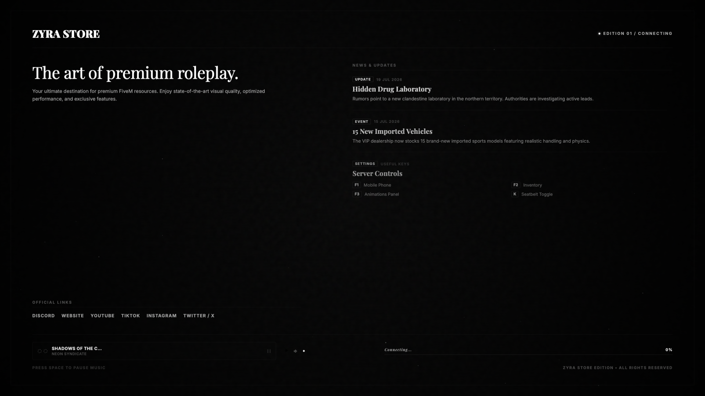
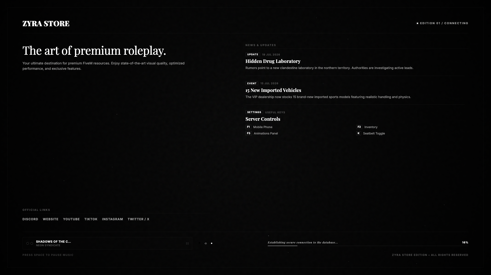

<p align="center">
  
  
  
</p>

# 📜 Zyra Loading Screen 4 - Cinematic Editorial Edition

Welcome to **Zyra-Loading-Screen-4**, an exclusive FiveM loading screen resource by **Zyra Store**. Crafted with a luxury magazine editorial layout featuring Playfair Display serif titles and Inter sans-serif body typography.

---

## 📸 Preview Showcase





---

## 🛠️ Key Features

- **Cinematic Editorial Layout:** Luxury magazine magazine aesthetic with high-fashion Playfair Display serif typography.
- **Radial SVG Progress Circle:** Vector-based circular percentage loader with smooth fill animations.
- **News & Slideshow Carousel:** Interactive slide deck highlighting community events, updates, and rules.
- **Modular Audio Player:** Music playlist player with album art covers, artist details, and NUI controls.
- **Clean Modular Architecture:** Separated CSS stylesheets and JS modules for optimal performance (`css/` and `js/`).

---

## 📦 Installation Instructions

1. **Copy the Resource:**
   Copy the `Zyra-Loading-Screen-4` directory to your FiveM `resources` folder:
   `resources/[zyra]/Zyra-Loading-Screen-4`

2. **Update `server.cfg`:**
   Add the following line to `server.cfg`:
   ```cfg
   ensure Zyra-Loading-Screen-4
   ```

3. **Start the Resource:**
   Restart your server or execute in console:
   ```cmd
   refresh
   ensure Zyra-Loading-Screen-4
   ```

---

## ⚙️ Configuration Guide (`js/config.js` / `config.js`)

- **Branding Details:** Edit server title, slogan, and logo image path.
- **Slideshow Articles:** Add images, headlines, and descriptions to the news carousel.
- **Audio Tracks:** Manage MP3 URLs, song names, and album cover thumbnails.

---

## ⛔ License & Commercial Restrictions

> [!CAUTION]
> **RESALE IS STRICTLY PROHIBITED (OPEN CODE RESOURCE)**
> This resource is released as **Open Code / Open Source**. Selling, re-selling, monetizing, or offering this resource on Tebex, Discord, or any commercial platform is **STRICTLY PROHIBITED**. You are permitted to modify and use this code freely on your personal FiveM servers, but commercial distribution is prohibited by **Zyra Store**.

---

## 💎 Credits & Support

Developed with ❤️ by **Zyra Store**.  
All rights reserved.
